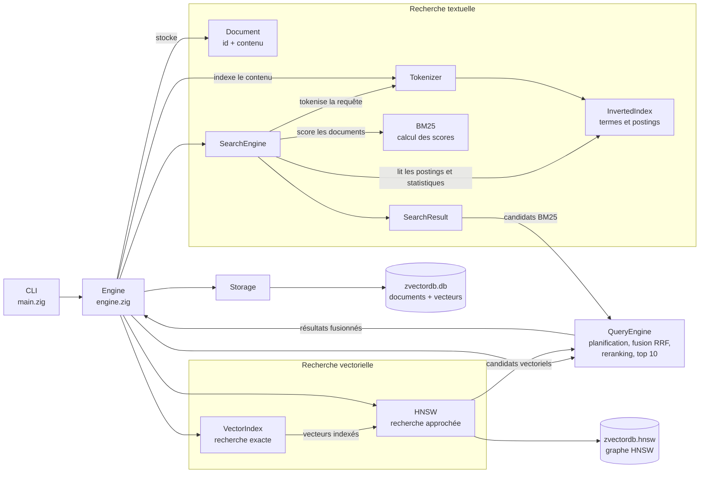
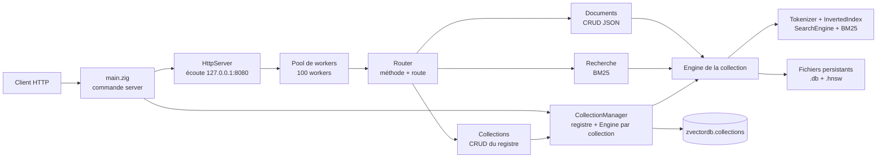

# ZvectorDB

Base de données vectorielle expérimentale et moteur de recherche textuelle écrit en Zig 0.16.

## Architecture actuelle

Ce diagramme présente les principaux composants et leurs relations dans le fonctionnement actuel de la CLI:



`Engine` orchestre les opérations et la persistance. Le flux textuel indexe le contenu des documents via `Tokenizer` et `InvertedIndex`; `SearchEngine` applique le scorer `BM25`. Le flux vectoriel utilise `VectorIndex` pour la recherche exacte et HNSW pour la recherche approchée. Pour `query` et `hybrid`, `QueryEngine` planifie les sources, fusionne les candidats et effectue le reranking. Les documents et les vecteurs doivent actuellement avoir des identifiants alignés dans le même ordre pour être fusionnés.

Le type `Document` actuellement utilisé par `Engine` est déclaré dans `engine.zig`; le fichier `src/document.zig` existe mais n'est pas encore relié à ce flux. `src/root.zig` exporte `Engine` comme module Zig. L'API HTTP v1 expose maintenant les opérations de base via des collections persistantes; les utilisateurs peuvent aussi continuer à passer par la CLI. Les composants WAL/snapshot et mmap restent expérimentaux et ne sont pas utilisés par l'Engine de la CLI.

### Architecture du serveur HTTP v1

Le serveur est une seconde entrée vers `Engine`, distincte de la CLI. Il reçoit des requêtes HTTP, les route vers les opérations JSON de l'API, puis délègue les opérations sur les documents et la recherche BM25 à l'`Engine` de la collection visée.



Au démarrage, `CollectionManager` charge le registre et ouvre un `Engine` par collection. Le serveur distribue chaque connexion à un worker; le routeur choisit ensuite le gestionnaire de collections, le CRUD de documents ou la recherche. Les réponses sont sérialisées en JSON. Le endpoint de recherche actuel utilise BM25; les fonctions vectorielles et hybrides disponibles via l'`Engine` ne sont pas encore exposées par ces routes HTTP.

## Démarrer la CLI

Depuis la racine du projet:

```sh
zig build run
```

La CLI utilise des couleurs ANSI pour distinguer l'invite, les résultats, les messages d'erreur et les confirmations. Dans Windows Terminal, le mode ANSI est activé automatiquement.

La CLI délègue l'orchestration à `Engine`, qui réunit documents/BM25, vecteurs/HNSW et query engine tout en conservant `zvectordb.db` et `zvectordb.hnsw`. Le `WalEngine` de bas niveau reste expérimental et n'est pas activé par la CLI. Les documents et les vecteurs sont enregistrés automatiquement après chaque insertion, puis restaurés au prochain lancement:

```text
zvectordb> add Zig est un langage de programmation système
zvectordb> add ZvectorDB recherche des documents avec BM25
zvectordb> search langage programmation
zvectordb> list
zvectordb> stats
zvectordb> quit
```

Commandes texte: `add <texte>`, `update <id> <nouveau texte>`, `delete <id>`, `search <requête>`, `search-and <mot1> <mot2>`, `index`, `list`, `stats`, `help`, `quit`. Après suppression, les documents suivants sont renumérotés.

La session expose aussi l'index vectoriel:

```text
zvectordb> dimension 3
zvectordb> vadd 1,0,0
zvectordb> vadd 0.9,0.1,0
zvectordb> vupdate 0 1,0.1,0
zvectordb> vsearch 1,0,0
zvectordb> hsearch 1,0,0
zvectordb> hybrid langage programmation --vector 1,0,0
zvectordb> query langage programmation --vector 1,0,0
zvectordb> vdelete 1
zvectordb> quantize 0.25,-0.5,1
zvectordb> train langage 100
```

`vsearch` fait une recherche exacte par similarité cosinus. `hsearch` utilise un graphe HNSW conservé en mémoire pendant la session et enregistré dans `zvectordb.hnsw`; il est restauré au prochain lancement et mis à jour avec les opérations vectorielles. `quantize` affiche les valeurs INT8 et le facteur d'échelle.

`hybrid <requête texte> --vector <csv>` lance le query engine avec BM25 et HNSW. Il faut un vecteur par document, dans le même ordre, afin que les identifiants correspondent.

`query <texte> [--vector <csv>]` affiche son plan de recherche (filtres, sources, nombre de candidats, fusion, reranking et limite), puis l'exécute. Il prend jusqu'à 50 candidats par source, fusionne les rangs par RRF, rerank les candidats avec les scores BM25 et cosinus normalisés (poids 50/50 si les deux sources ont des résultats), puis retourne jusqu'à 10 résultats. Sans vecteur de requête, il utilise BM25 seul; sans texte, HNSW seul. Les filtres restent désactivés tant que les documents ne portent pas de métadonnées indexées.

`vupdate <id> <csv>` modifie un vecteur et `vdelete <id>` le supprime. Les vecteurs suivants sont renumérotés après suppression.

`train <mot> [époques]` entraîne un modèle Word2Vec sur les documents et affiche les cinq voisins du mot. Le modèle Word2Vec reste temporaire; les documents et les vecteurs de la CLI sont conservés dans `zvectordb.db`, et le graphe HNSW dans `zvectordb.hnsw`, dans le répertoire courant. Le stockage WAL/snapshot et mmap existent comme modules expérimentaux séparés.

## Benchmark HNSW

Lancez le benchmark avec:

```sh
zig build benchmark
```

Il construit un index de 10 000 vecteurs de 128 dimensions puis exécute 1 000 recherches HNSW. Le rapport affiche le débit, la latence moyenne, P50/P95/P99, le temps CPU du processus, son working set mémoire, et le nombre/volume des allocations effectuées par les recherches. Les métriques système CPU et RAM sont disponibles sous Windows; les compteurs d'allocations des recherches sont suivis par l'allocateur de mesure.

Première mesure de référence avec `ReleaseFast`:

| Mesure | Résultat |
|---|---:|
| Débit | 8 224,45 recherches/s |
| Latence moyenne | 121,59 µs |
| P50 | 112,10 µs |
| P95 | 161,70 µs |
| P99 | 212,60 µs |
| CPU processus | 102,8 % |
| Working set RAM | 21,33 MiB |
| Allocations | 5 000 appels, 7 760 000 octets alloués, pic de 7 360 octets vivants |

## API HTTP v1

Le serveur HTTP expose le moteur sur `127.0.0.1` (port `8080` par défaut). Lancez-le avec:

```sh
zig build run -- server [port]
```

Routes disponibles:

| Méthode | Route | Fonction |
|---|---|---|
| `GET` | `/api/v1/collections` | Lister les collections |
| `POST` | `/api/v1/collections` | Créer avec `{"name":"articles"}` |
| `GET` | `/api/v1/collections/{name}` | Lire une collection |
| `DELETE` | `/api/v1/collections/{name}` | Supprimer une collection et ses fichiers |
| `GET` | `/api/v1/collections/{name}/documents` | Lister les documents |
| `POST` | `/api/v1/collections/{name}/documents` | Ajouter `{"content":"..."}` |
| `GET` | `/api/v1/collections/{name}/documents/{id}` | Lire un document |
| `PUT` | `/api/v1/collections/{name}/documents/{id}` | Remplacer son contenu |
| `DELETE` | `/api/v1/collections/{name}/documents/{id}` | Supprimer le document |
| `POST` | `/api/v1/collections/{name}/search` | Recherche BM25 avec `{"query":"..."}` |

Les collections sont enregistrées dans `zvectordb.collections`. La collection `default` continue d’utiliser `zvectordb.db` et `zvectordb.hnsw`; les autres collections ont leurs propres fichiers `zvectordb.collection.{name}.db` et `.hnsw`. L’API écoute uniquement sur l’interface locale et accepte les requêtes HTTP/1.1 avec un corps JSON limité à 1 Mio.
